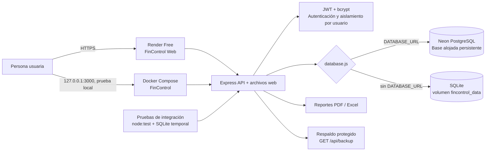

# Arquitectura de FinControl

El navegador sirve la interfaz desde Express y consume la API JSON. Express valida la sesión JWT y aplica el identificador de usuario en las consultas. El adaptador `database.js` usa SQLite con volumen persistente en Docker local y PostgreSQL en Neon para el sitio alojado.

## Componentes

- `public/`: interfaz adaptable para escritorio y móvil.
- `server.js`: API, autenticación, presupuestos, metas, notificaciones y reportes.
- `database.js`: esquema y acceso compatible con SQLite y PostgreSQL.
- `Dockerfile` y `compose.yaml`: entorno local y empaquetado de producción.
- `render.yaml`: servicio gratuito web y variables de entorno de Render.
- `test/api.test.js`: flujo de integración sobre una base SQLite desechable.

## Datos y persistencia

Las tablas principales son `users`, `categories`, `movements`, `budgets`, `goals` y `alerts`. En local, Compose monta el volumen `fincontrol_data` en `/app/data`. En producción, la base vive en Neon y no depende del sistema de archivos efímero de Render. `GET /api/backup` produce una copia consistente; necesita `BACKUP_TOKEN` y no realiza copias programadas.
